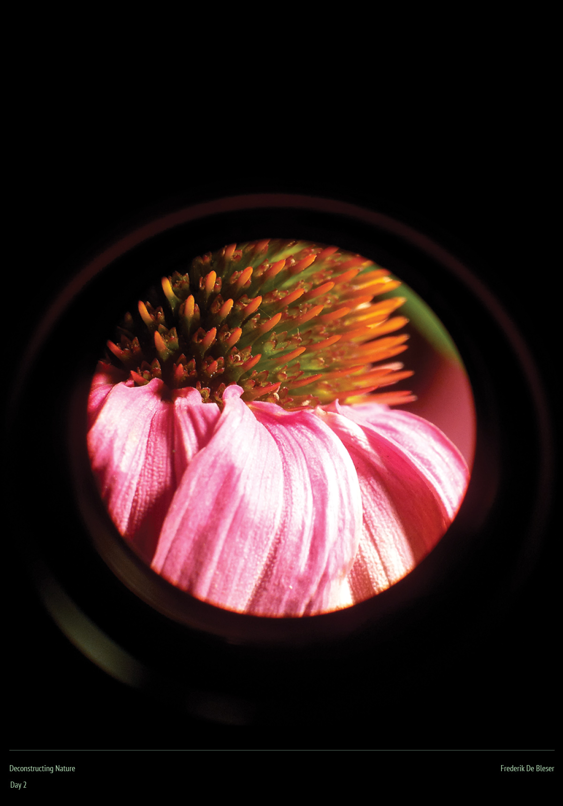
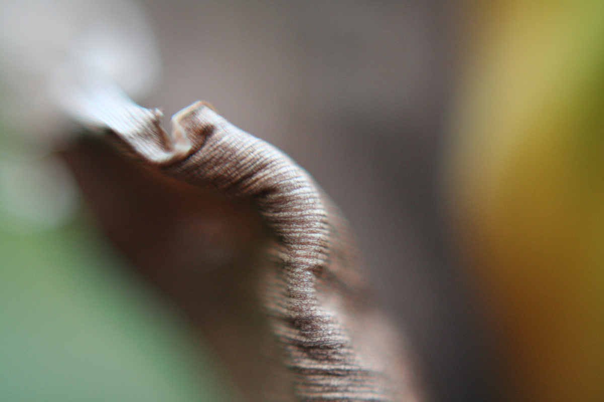
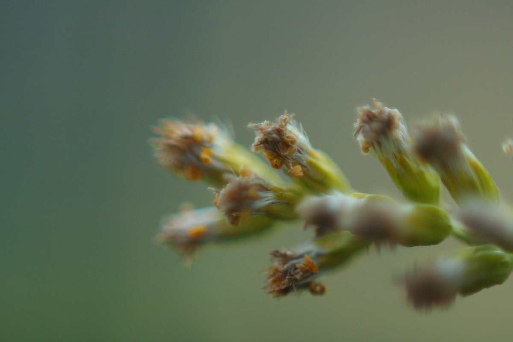
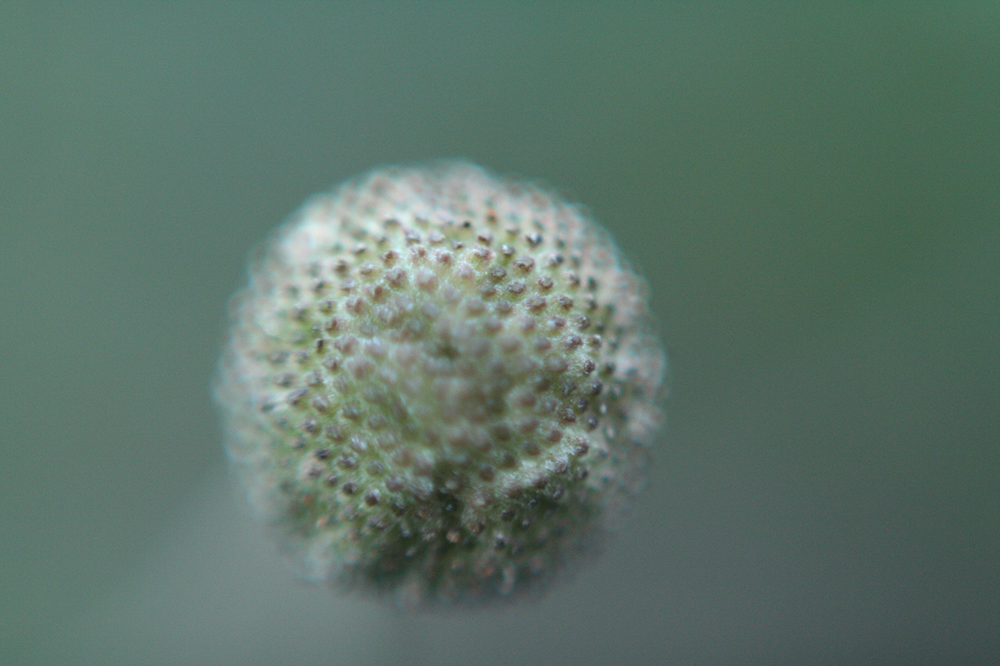
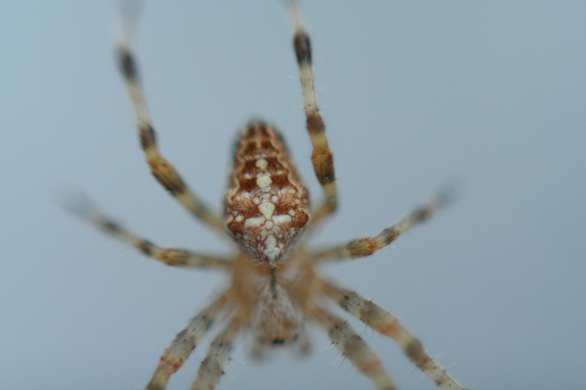
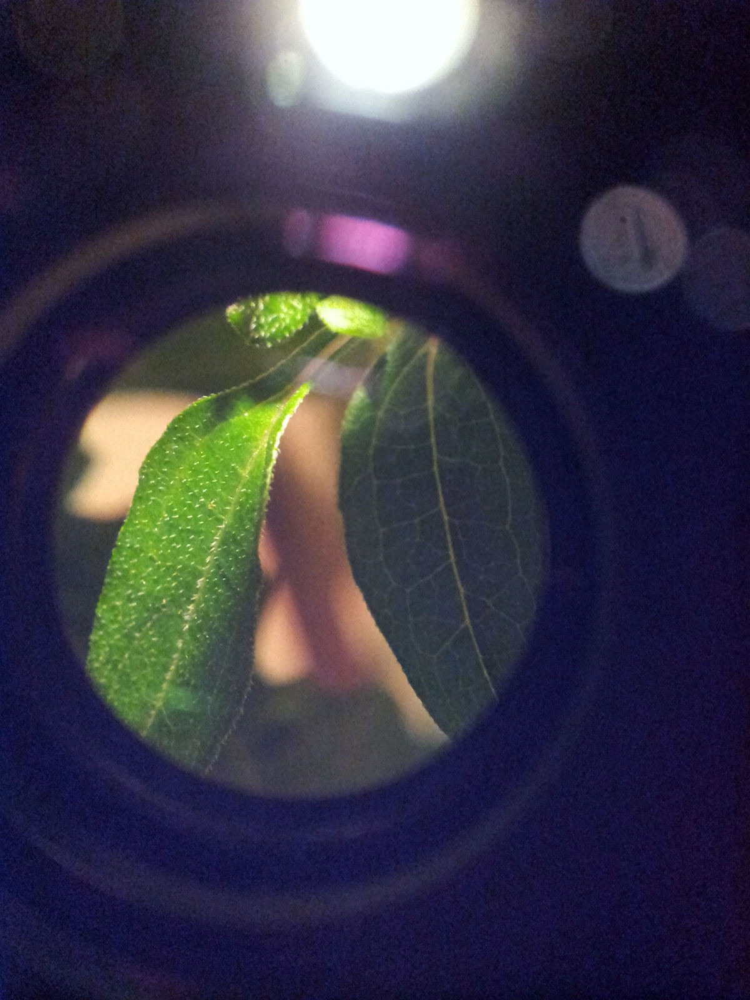

_My colleague Werner and I are holding a challenge this week to produce one visual work each day. I'm working around the theme of "Deconstructing Nature"._

[Day 1](/posts/2012-09-04-deconstructing-nature-day1/) — [Day 2](/posts/2012-09-05-deconstructing-nature-day2/) — [Day 3](/posts/2012-09-06-deconstructing-nature-day3/) — [Day 4](/posts/2012-09-07-deconstructing-nature-day4/) — [Day 5](/posts/2012-09-08-deconstructing-nature-day5/)

For the second day I wanted to do something _physical_. I was thinking about the act of deconstructing – breaking something down to its simplest components. "Simpling".

This brought me to the idea of microscopy. I discovered that you can do extreme macro-photography by installing the lens _backwards_ on a camera.

I did some experiments with my aging DSLR, but results were not as sharp as I hoped. However, I discovered that I can "attach" a regular lens to my smartphone, producing very detailed images. I used this technique to create the final image.

Here's the result from day 2:

Here are some other images from this session:

